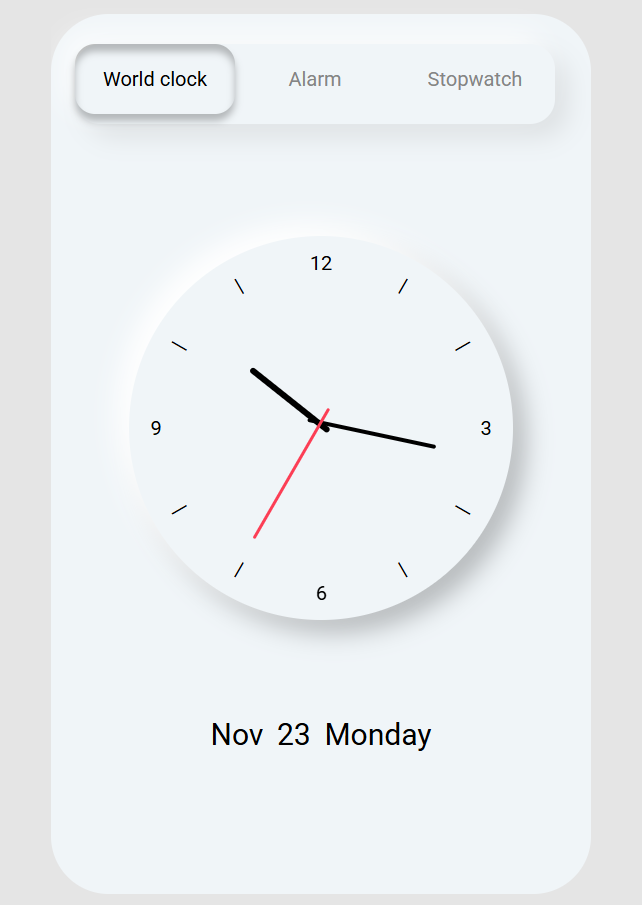

# ⌚ Clockify

A modern and responsive clock web application built using **HTML, CSS, and JavaScript**, featuring a real-time analog clock, alarm, and stopwatch/timer in one clean interface.

## 📌 About the Project

This project was developed to build a complete, interactive time management web app while practicing DOM manipulation, CSS layout responsiveness, and JavaScript time-based logic. It combines an analog clock with live date display alongside dedicated alarm and stopwatch/timer sections.

## 📱 App Preview

<table>
  <tr>
    <td align="center" style="border: none;"><strong>🕒 World Clock</strong></td>
    <td align="center" style="border: none;"><strong>⏰ Alarm</strong></td>
    <td align="center" style="border: none;"><strong>⏱️ Stopwatch / Timer</strong></td>
  </tr>
  <tr>
    <td align="center" style="border: none;"></td>
    <td align="center" style="border: none;"></td>
    <td align="center" style="border: none;"></td>
  </tr>
</table>

## 🧭 Navigation Guide

* 🕒 **World clock:** Opens the live analog clock with moving hour, minute, and second hands along with the current date display.
* ⏰ **Alarm:** Opens the alarm section to set and manage alarms seamlessly.
* ⏱️ **Stopwatch:** Opens the timer/stopwatch section with time tracking and countdown controls.

## ✨ Features

- Real-time analog clock with moving hour, minute, and second hands.
- Live formatted date display showing month, date, and weekday.
- Smooth tab navigation between World Clock, Alarm, and Stopwatch/Timer sections.
- Responsive neumorphic design tailored for both desktop and mobile screens.

## 🛠️ Technologies Used

- **HTML5** – Semantic structure of the application.
- **CSS3** – Neumorphic styling, animations, and responsive layout.
- **JavaScript** – Real-time clock rotation, date formatting, and tab switching interactivity.